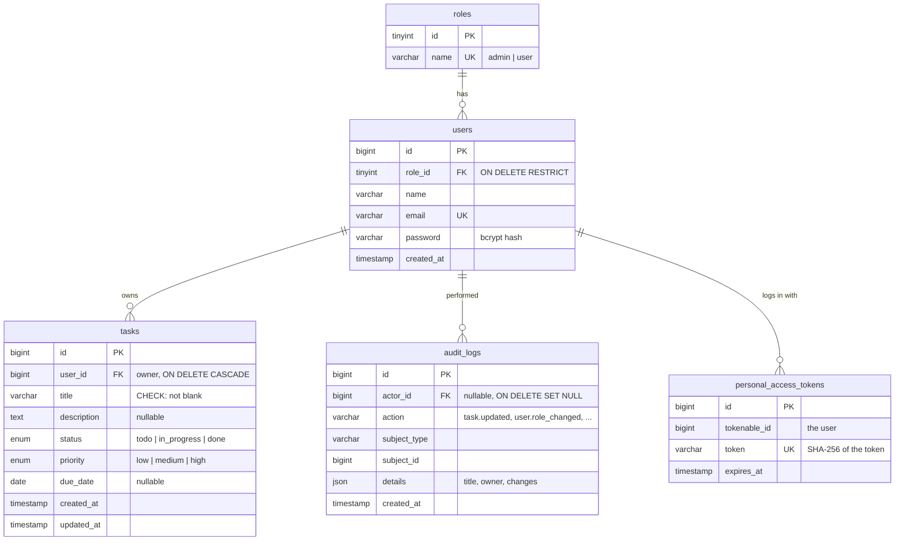

# Database design & query tuning (Task 3)

The schema is built by the Laravel migrations in
[`database/migrations`](../database/migrations). The exact DDL they
produce, exported from MySQL, is in [`schema.sql`](schema.sql).

## Schema



### Decisions worth calling out

| Decision | Why |
|---|---|
| A `roles` table and `users.role_id` | Roles are data, not strings scattered through the code. Adding a "manager" role later is an `INSERT`, not a migration. Both roles are inserted by the migration itself because the app can't run without them. |
| `ON DELETE RESTRICT` on `users.role_id` | You can't delete a role while people still have it. |
| `ON DELETE CASCADE` on `tasks.user_id` | A task without an owner makes no sense. Deleting a user removes their tasks. |
| `ON DELETE SET NULL` on `audit_logs.actor_id` | The audit trail has to outlive the admin who made the change. |
| `ENUM` for `status` and `priority` | A small, fixed set. One byte per row, MySQL itself rejects unknown values, and the API validates against the same PHP enums (`App\Enums\TaskStatus`, `TaskPriority`). |
| `CHECK (CHAR_LENGTH(TRIM(title)) > 0)` | Last line of defence against blank titles, even if someone bypasses the API. MySQL enforces CHECK from 8.0.16. |
| `UNIQUE (email)` | Enforced by the database, not only by the validator, which could race between "check" and "insert". |
| `email VARCHAR(190)` | Keeps the unique index inside InnoDB's key-size limit with 4-byte utf8mb4 characters. |
| Tokens stored hashed | Sanctum keeps only a SHA-256 of each token, so a database leak doesn't hand out working logins. Each token has an `expires_at`. |
| `due_date` as `DATE`, not `DATETIME` | A due date is a calendar day. No timezone shifts. |
| `details` as `JSON` | Each action records different facts (a list of changed fields vs. a role change). JSON keeps that flexible without a table per action. |

## Indexes on `tasks`

```sql
PRIMARY KEY (id)
KEY tasks_user_status_index (user_id, status)
KEY tasks_user_recent_index (user_id, id)
KEY tasks_status_index      (status)
```

The key fact behind all of them: **InnoDB appends the primary key to every secondary
index.** So `(user_id, status)` is physically `(user_id, status, id)`, and `(status)`
is `(status, id)`. Every list in the app is sorted `ORDER BY id DESC` (newest first),
so the rows come out of the index already sorted and MySQL can stop after one page.

I sort by `id` rather than `created_at` on purpose. Ids grow with time just like
`created_at`, but they are unique (stable pagination, no ties between rows created in
the same second) and they're already in every index.

| Index | What it serves |
|---|---|
| `tasks_user_status_index` | "My tasks with status X", the per-status counts (index-only), the admin team counts, **and the foreign key on `user_id`** (MySQL reuses it, so there's no separate FK index) |
| `tasks_user_recent_index` | "All my tasks", newest first |
| `tasks_status_index` | Admin: everyone's tasks with status X |
| `PRIMARY` | Admin: everyone's tasks, no filter (reads the primary key backwards) |

## The queries the app actually runs

The SQL below is exactly what Eloquent generates; it was captured from the running
controllers with the query log. Measured on MySQL 8.4 with **20,014 tasks across 54 users**
(`php artisan db:seed --class=BulkTaskSeeder`), using `EXPLAIN ANALYZE`. User 5 has 400 tasks.

### Query 1: a user's tasks filtered by status (the main list)

`GET /api/tasks?status=todo` in `TaskController::index`

```sql
select * from `tasks` where `user_id` = 5 and `status` = 'todo' order by `id` desc limit 10 offset 0
```

```
-> Limit: 10 row(s)  (actual time=0.223..1.17 rows=10 loops=1)
    -> Index lookup on tasks using tasks_user_status_index (user_id=5, status='todo') (reverse)
       (cost=44.8 rows=128) (actual time=0.219..1.16 rows=10 loops=1)
```

An index lookup on both columns, read backwards, and it stops after exactly 10 rows.
No sort step. The paginator's total is answered by the index alone:

```
select count(*) as aggregate from `tasks` where `user_id` = 5 and `status` = 'todo'
-> Covering index lookup on tasks using tasks_user_status_index (user_id=5, status='todo')  (actual time=0.0478..0.157 rows=128)
```

The task owners for the page are then loaded in **one** query by primary key
(`select * from users where id in (5)`), not one query per task (no N+1).

### Query 1b: all of a user's tasks (no status filter). This one needed tuning.

```sql
select * from `tasks` where `user_id` = 5 order by `id` desc limit 10 offset 0
```

Left alone, the optimizer picks `tasks_user_status_index`, reads **all 400** of the
user's rows and sorts them, just to return 10:

```
-> Limit: 10 row(s)  (actual time=3.39..3.39 rows=10 loops=1)
    -> Sort: tasks.id DESC, limit input to 10 row(s) per chunk  (actual time=3.39..3.39 rows=10)
        -> Index lookup on tasks using tasks_user_status_index (user_id=5)  (actual time=0.0466..2.92 rows=400)
```

`tasks_user_recent_index (user_id, id)` already holds this user's tasks in id order,
so MySQL could walk it backwards and stop at row 10. The cost model doesn't give
enough credit for that early stop, so the controller adds a hint, **only for this
case** (one person's tasks, no status filter):

```php
->when($ownerId && ! $status, fn ($query) => $query->useIndex('tasks_user_recent_index'))
```

```sql
select * from `tasks` use index (tasks_user_recent_index) where `user_id` = 5 order by `id` desc limit 10 offset 0
```

```
-> Limit: 10 row(s)  (actual time=0.0868..0.288 rows=10 loops=1)
    -> Index lookup on tasks using tasks_user_recent_index (user_id=5) (reverse)  (actual time=0.0853..0.282 rows=10)
```

| | Rows read | Time |
|---|---|---|
| Page 1, before | 400 + sort | 3.39 ms |
| Page 1, after | **10** | **0.29 ms** |
| Page 30 (`offset 290`), before | 400 + sort | 20.9 ms |
| Page 30 (`offset 290`), after | 300 | 1.9 ms |

The gap grows with the number of tasks a person has. I used `USE INDEX` rather than
`FORCE INDEX`: it is the lighter hint, and it was enough here.

### Query 2: admin view of everyone's tasks, with owner info

`GET /api/tasks?status=todo` as an admin

```sql
select * from `tasks` where `status` = 'todo' order by `id` desc limit 10 offset 0
```

```
-> Limit: 10 row(s)  (actual time=0.0563..0.119 rows=10 loops=1)
    -> Index lookup on tasks using tasks_status_index (status='todo') (reverse)  (cost=787 rows=6667) (actual time=0.0545..0.115 rows=10)
```

About 6,700 tasks match, but because `(status)` is really `(status, id)`, MySQL reads
just 10 of them. Without a status filter it reads the primary key backwards:

```
select * from `tasks` order by `id` desc limit 10 offset 0
-> Index scan on tasks using PRIMARY (reverse)  (actual time=0.0448..0.0773 rows=10)
```

Owner names come from a second primary-key lookup for the (at most 10) owners on the
page. I kept that as Eloquent eager loading rather than a `JOIN`: both queries are
cheap index lookups, and the code stays a readable `->with('owner')`.

### Query 3: task counts per status (the stats cards)

`GET /api/tasks/stats` in `TaskController::stats`

```sql
select status, COUNT(*) AS total from `tasks` where `user_id` = 5 group by `status`
```

```
-> Group aggregate: count(0)  (actual time=0.217..0.572 rows=3 loops=1)
    -> Covering index lookup on tasks using tasks_user_status_index (user_id=5)  (actual time=0.0524..0.418 rows=400)
```

"Covering" means MySQL never touches the table rows. Everything it needs (`user_id`,
`status`) is in the index, which is also already grouped by status.

### Query 4: the admin team page (tasks per person, per status)

`GET /api/admin/users` in `Admin\UserController::index`, written with `withCount()`:

```sql
select `users`.*,
  (select count(*) from `tasks` where `users`.`id` = `tasks`.`user_id`) as `tasks_count`,
  (select count(*) from `tasks` where `users`.`id` = `tasks`.`user_id` and `status` = 'todo') as `todo_count`,
  (select count(*) from `tasks` where `users`.`id` = `tasks`.`user_id` and `status` = 'in_progress') as `in_progress_count`,
  (select count(*) from `tasks` where `users`.`id` = `tasks`.`user_id` and `status` = 'done') as `done_count`
from `users` order by `name` asc
```

```
-> Sort: users.name  (actual time=2.88..3.06 rows=54 loops=1)
    -> Table scan on users  (rows=54)
-> Select #3 (subquery in projection; dependent)
    -> Aggregate: count(0)  (actual time=0.266..0.266 rows=1 loops=54)
        -> Covering index lookup on tasks using tasks_user_status_index (user_id=users.id, status='todo')  (rows=123 loops=54)
   ... the same for the other three counts
```

Every subquery is an index-only lookup on `(user_id, status)`. **3 ms in total.**

I also measured the "obvious" alternative, a single grouped query:

```sql
select user_id, status, count(*) from tasks group by user_id, status
-> Covering index scan on tasks using tasks_user_status_index  (actual time=0.146..37.7 rows=20014)
-> Group aggregate (actual time=0.16..56.9 rows=159)
```

It scans every entry in the index: **57 ms**, about 19× slower here, and it would need
extra PHP to merge the counts back onto the users. So the simpler `withCount()`
version is also the faster one. (With thousands of users this would be worth
revisiting, e.g. by paginating the team list.)

## What I'd do next at a larger scale

- **Keyset pagination** (`where id < :last_seen_id order by id desc limit 10`) instead
  of `OFFSET`, so page 500 costs the same as page 1. The `(user_id, id)` and
  `(status, id)` index shapes already support it.
- **Cache the stats cards** per user for a few seconds if they become a hot path.
  Today they cost well under a millisecond.
- **Full-text search** on `title`/`description` would need a `FULLTEXT` index. It's out
  of scope for this assessment.
